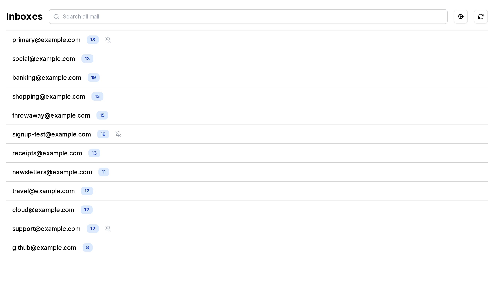
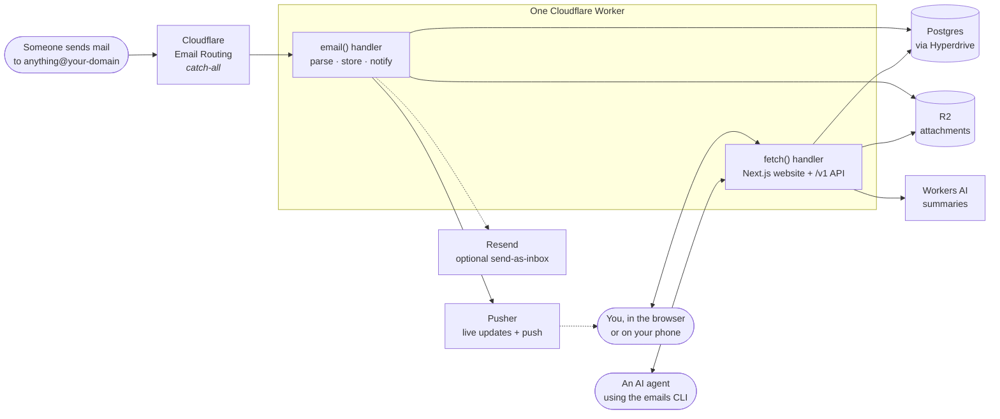
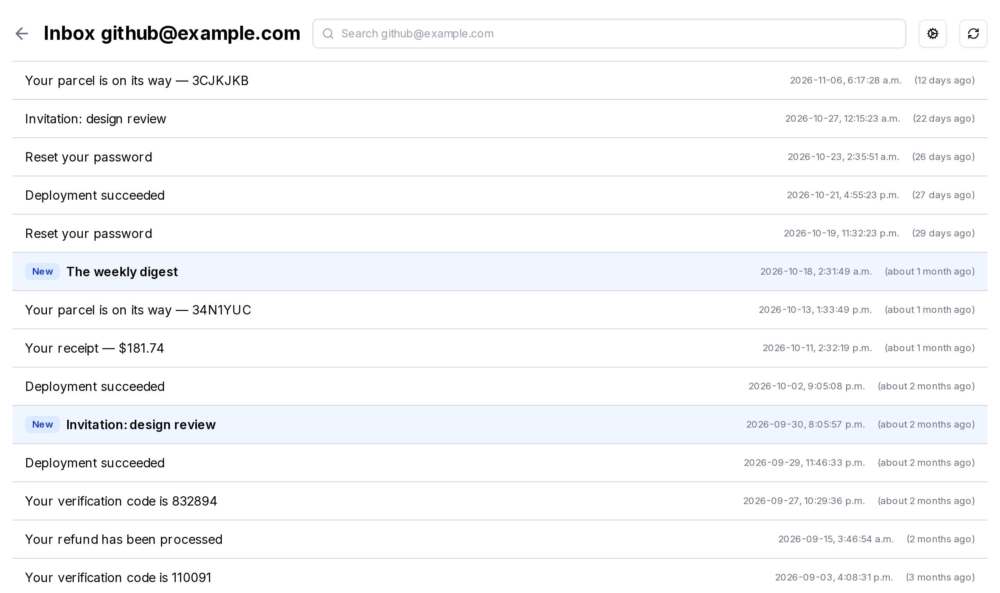
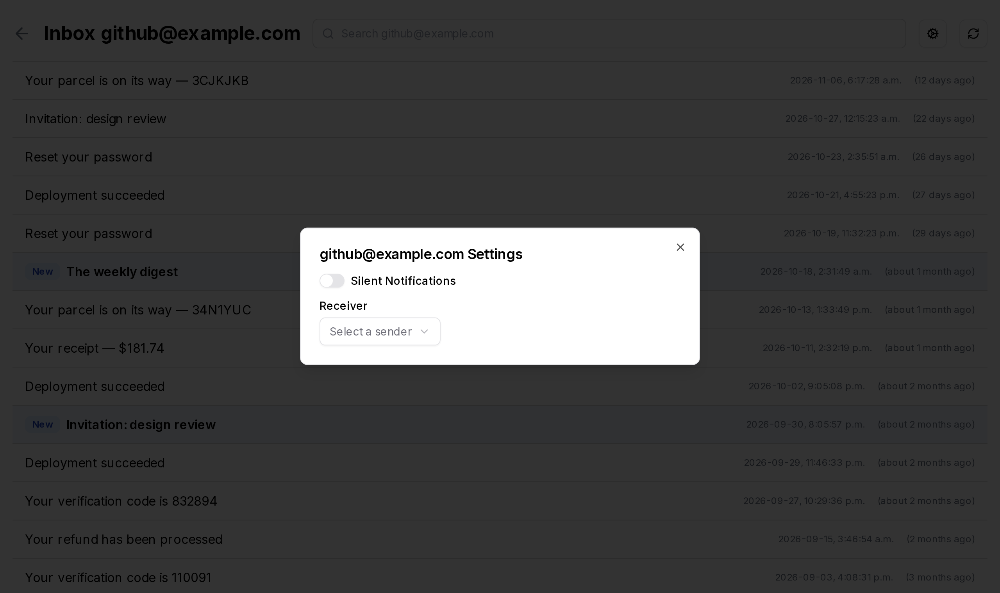
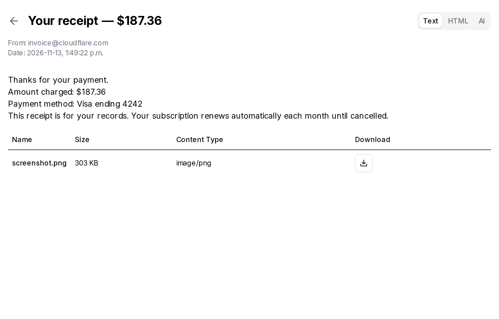
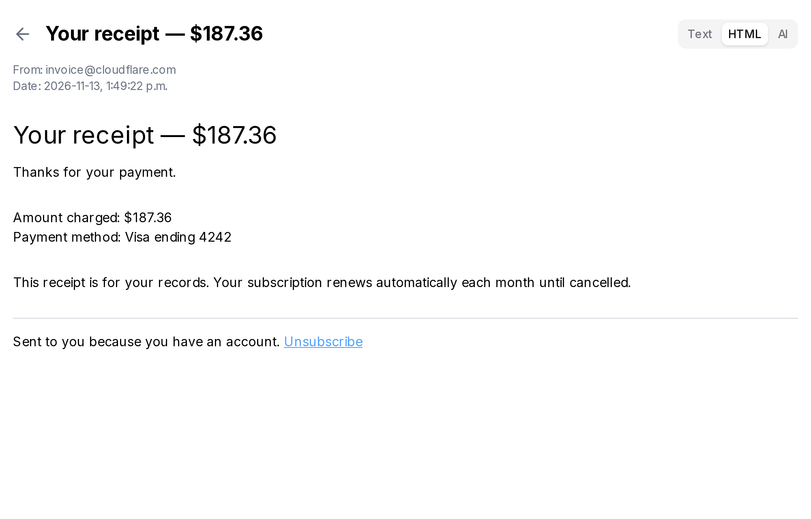
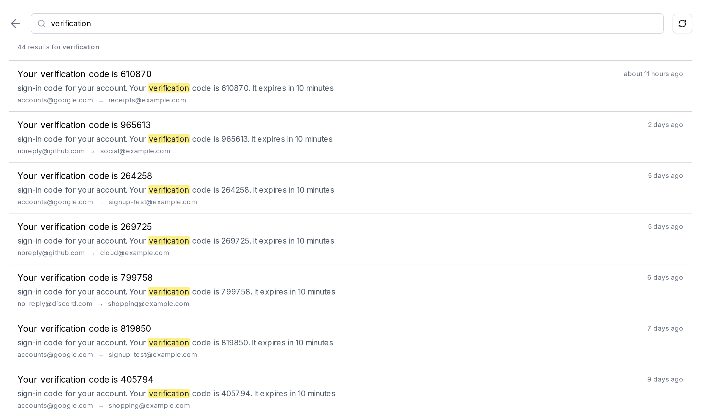
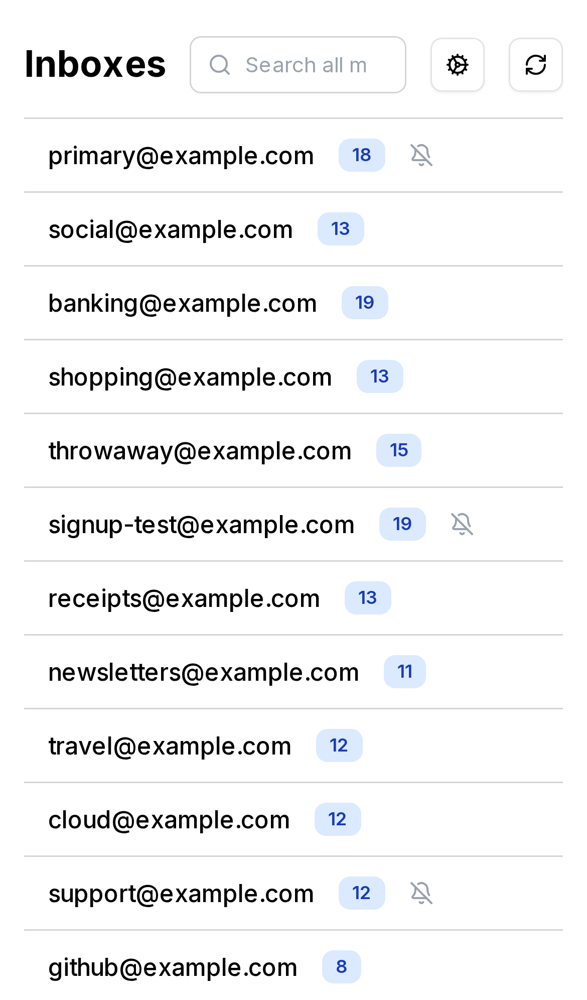

# emails

**Disposable inboxes on your own domain.** Point a catch-all domain at this
project and every address on it — `anything@your-domain` — just works. Mail
lands in a private web inbox, pings your phone, and is readable by AI agents
through a small CLI.



## Why

- **Sign up for things without handing out your real address.** Make up a new
  address on the spot; it already exists.
- **Let agents receive mail.** An agent can mint an address, hand it to a signup
  form, and wait for the verification email — no human in the loop.
- **Own it.** It's one Cloudflare Worker and one Postgres database. No
  third-party inbox service sees your mail.

## What you get

| | |
|---|---|
| **Catch-all inboxes** | Any address on the domain receives mail. Inboxes appear the first time something is sent to them. |
| **Web app** | Inbox list, per-inbox view, plain text / HTML / AI-summary tabs, attachment downloads. Installable as a phone app (PWA). |
| **Live updates** | New mail lights up the refresh button instantly and sends a push notification — per inbox, mutable. |
| **Search** | Full-text search across all mail, with `"phrases"` and `-exclusions`. |
| **AI summary** | One-click summary of any email via Workers AI. |
| **CLI for agents** | `emails address new`, `emails wait …` — JSON out, built for scripts and AI agents. |
| **Send as an inbox** | Optional: mail *you* send to an inbox (DMARC-verified) is relayed to that inbox's chosen recipient, from the inbox's address — so you can reply without revealing your real one. |

## How it works

One Cloudflare Worker does everything. Its `email()` handler receives mail; its
`fetch()` handler serves the website and the CLI's API.



The life of one email:

1. **Arrives.** Cloudflare Email Routing hands the message to the Worker's
   `email()` handler.
2. **Stored.** It's parsed and saved to Postgres. Attachments (and any oversized
   body) go to R2. Storing happens first, before anything else can fail.
3. **Announced.** Pusher pings any open browser so the inbox refreshes, and
   sends a push notification unless the inbox is muted.
4. **Read.** You open it on the website; an agent fetches it over the `/v1` API.

## A tour

### Inbox list

Every address that has received mail (the screenshot at the top), newest
activity first. The badge is the unread count; a crossed-out bell means the
inbox is muted.

### An inbox

All mail for one address. Its settings let you mute notifications or pick who
mail sent *as* this inbox goes to.

| Inbox | Settings |
|---|---|
|  |  |

### An email

Read as plain text, as the original HTML, or as an AI summary (the **AI**
tab). Attachments are listed under the message and download straight from R2.

| Text + attachments | HTML |
|---|---|
|  |  |

### Search

Postgres full-text search over subject, sender and body, with the matching
words highlighted. Subject matches rank highest.



### On your phone

Add it to your home screen and it behaves like a native mail app, with push
notifications.



## The CLI (for agents)

A small Rust binary that talks to the `/v1` API. Output is JSON by default, so
agents can pipe it straight into `jq`.

```bash
ADDR=$(emails address new | jq -r .address)   # make up a fresh address
emails inbox mute "$ADDR"                       # don't buzz my phone
# … give $ADDR to a signup form …
emails wait "$ADDR" --timeout 180 --subject verify   # block until it arrives
```

Install and configure it from [`cli/`](cli/README.md). An agent skill that
teaches agents to use it lives at
[`cli/skills/emails/SKILL.md`](cli/skills/emails/SKILL.md).

## Tech stack

| Piece | What it's for |
|---|---|
| [Cloudflare Workers](https://developers.cloudflare.com/workers/) + [Email Routing](https://developers.cloudflare.com/email-routing/) | Runs everything; receives the mail |
| [Next.js](https://nextjs.org/) via [OpenNext](https://opennext.js.org/cloudflare) | The website and API |
| Postgres ([Neon](https://neon.tech/)) via [Hyperdrive](https://developers.cloudflare.com/hyperdrive/) + [Drizzle](https://orm.drizzle.team/) | Mail storage and search |
| [R2](https://developers.cloudflare.com/r2/) | Attachments and oversized bodies |
| [Workers AI](https://developers.cloudflare.com/workers-ai/) | Email summaries |
| [Clerk](https://clerk.com/) | Sign-in, locked to an allowlist of users |
| [Pusher](https://pusher.com/) Channels + Beams | Live refresh and push notifications |
| [Resend](https://resend.com/) | Optional send-as-inbox relay |
| [Infisical](https://infisical.com/) + [varlock](https://varlock.dev/) | Secrets (no `.env` files with values) |
| Rust | The `emails` CLI |

## Repo layout

```
worker.ts        the Worker entry: the Next.js app + the email() handler
src/app/         website pages, and the /v1 API for the CLI (src/app/v1)
src/email/       inbound mail pipeline, forwarding rules, reading emails
src/inbox/       inbox queries
src/search/      full-text search
src/database/    schema, migrations, dev seeder
cli/             the Rust `emails` CLI
```

## Running it locally

You need Node (see `.nvmrc`), pnpm, and access to the project's Infisical dev
environment — every script pulls its secrets from there.

```bash
pnpm install
pnpm db:seed:dev   # fill the dev database with fake mail
pnpm dev           # http://localhost:3000
pnpm test          # end-to-end tests against the seeded dev database
```

Deploys happen only in CI: a push to `main` runs migrations, builds, and deploys
via Cloudflare Workers Builds.

**Before changing anything, read [`AGENTS.md`](AGENTS.md).** It's the detailed
operating manual — databases, migrations, deploys, secrets, and the many
sharp edges found along the way.

## License

[AGPL-3.0](LICENSE). If you run a modified copy as a service for others, you must publish your changes.
